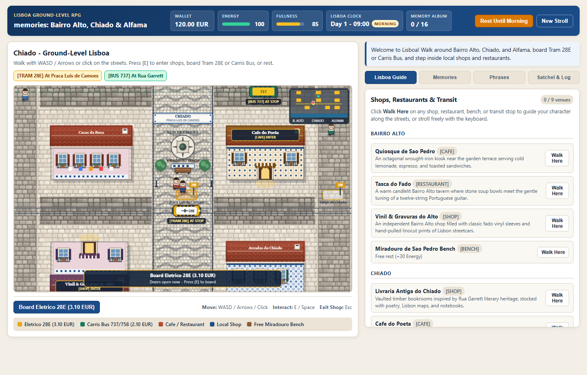

# memories: Ground-Level Lisboa Exploration

**memories** is a ground-level 2D RPG canvas exploration game set across three historic neighborhoods of Lisboa: **Bairro Alto**, **Chiado**, and **Alfama**. Walk the cobblestones on foot, board live-moving **Carris Eletrico 28E** streetcars and **Carris Bus 737 / 758** coaches, step inside local shops and restaurants, taste regional food, collect keepsakes, learn European Portuguese phrases, and fill your 16-entry **Lisboa Memory Album**.

## Screenshot



## Features

- **Navigable RPG City Canvas**: Explore a continuous street-level map linking Bairro Alto (west), Chiado and Praca Luis de Camoes (center), and Alfama with Se de Lisboa and the Tagus waterfront (east) using `WASD` / Arrow keys or click-to-walk, featuring procedural cobalt *azulejo* tile facades, terracotta barrel-tile roofs, wrought-iron Juliet balconies, *calçada portuguesa* Mar Largo plazas, and hand-laid cobblestone streets.
- **Live Street-Level Public Transit**:
  - **Eletrico 28E (Carris Tram)**: Glides along steel rails between Rua do Loreto, Praca Luis de Camoes, Largo do Chiado, Se de Lisboa, and Portas do Sol (`3.10 EUR`).
  - **Carris Bus 737 / 758**: Loops past Miradouro de Sao Pedro de Alcantara, Rua Garrett, Miradouro de Santa Luzia, and the Tagus waterfront (`2.10 EUR`).
  - Board at marked transit shelters, ride visibly inside the moving vehicle, ring the bell to step off at the next stop, and save Energy on uphill stretches.
- **9 Enterable Shops, Cafes, and Restaurants**:
  - **Bairro Alto**: *Quiosque de Sao Pedro*, *Tasca do Fado*, *Vinil & Gravuras do Alto*.
  - **Chiado**: *Livraria Antiga do Chiado*, *Cafe do Poeta*, *Atelier de Cortica & Luvas*.
  - **Alfama**: *Oficina de Azulejos*, *Taberna da Sardinha*, *Mercearia & Conservas de Alfama*.
  - Step through any glowing storefront doorway to explore its custom interior room, walk up to the proprietor counter or local display, order traditional Lisbon dishes or coffee, buy handcrafted souvenirs, and return seamlessly to the street.
- **Gentle Memories Collection Loop**:
  - Manage **Wallet (EUR)**, **Energy**, and **Fullness** as Lisbon shifts from Morning through Afternoon, Golden Hour, and Lantern Evening.
  - Rest free at three scenic **Miradouro Benches** or take a gentle overnight stay at a neighborhood pensao without harsh game-over lockouts.
  - Capture **16 Memories** and unlock contextual **European Portuguese phrases** with phonetic pronunciation guides.

## Project Structure

- `index.html`: Main RPG viewport shell, HUD metrics, and Lisboa Explorer notebook panels.
- `styles.css`: Responsive Lisbon-themed styling.
- `src/data.js`: Overworld street and neighborhood layout, 9 enterable venues with menus and keepsakes, 3 miradouro rest benches, Carris Tram 28E and Bus 737/758 routes, phrases, and Memory Album catalog.
- `src/engine.js`: Pure ES module simulation engine (`MemoriesGameEngine`) managing movement, collisions, live transit vehicles, interior transitions, resource loops, and memory unlocking.
- `src/renderer.js`: HTML5 2D Canvas RPG renderer for overworld streets, animated character and vehicles, mini-map, time-of-day lighting, and interior rooms.
- `src/app.js`: Browser controller handling keyboard and click-to-walk input, street routing, animation frame updates, and interactive DOM panels.
- `tests/engine.test.js`: Automated unit, integration, and compliance test suite using `node --test`.

## Running Locally

Because the application uses native ES modules (`<script type="module">`), serve the workspace over HTTP:

```bash
python -m http.server 8000
```

Then open `http://localhost:8000` in your browser.

## Running Tests

Requires Node.js 20+:

```bash
npm test
```

or directly:

```bash
node --test tests/engine.test.js
```
